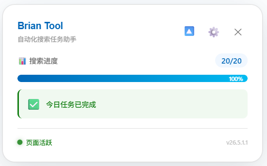
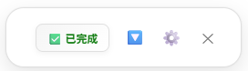
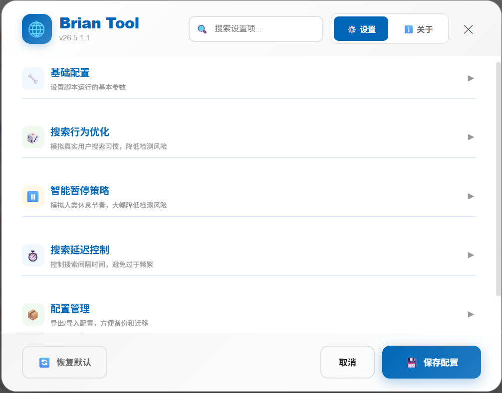
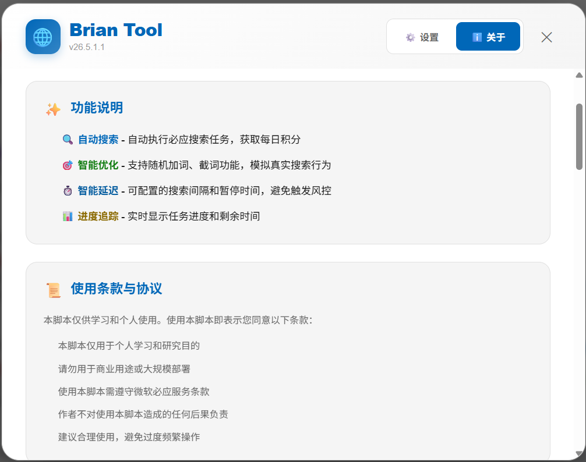

# 🌐 浏览器脚本版（推荐）

> 纯粹的前端用户脚本，运行于浏览器沙盒环境，跨平台支持，轻量便捷，**官方推荐版本**。

| 项目 | 说明 |
|------|------|
| 技术栈 | JavaScript (ES6+) + Violentmonkey API |
| 当前版本 | `26.10.31.1` |
| 安装方式 | 一键安装，无需构建，自动更新 |

---

## ✨ 核心特性

- **全自动执行**：一键启动，自动完成当日所有搜索与日常任务，实时显示进度
- **日常任务自动点击**：自动点击待完成且有积分的日常任务及 Dashboard `#dailyset` 区域未完成任务
- **APP 端任务**：支持 APP 端每日签到与资讯阅读，一键授权、令牌自动续期，实时显示阅读 X/Y 进度
- **安全模拟**：自动获取热搜词并随机使用，支持随机加词/截词、随机滚动、随机延迟
- **隐私保护**：纯前端运行，**不收集、不上传任何 Cookie 或个人信息**
- **现代 UI**：实时状态面板、图形化设置、自动适配暗色模式

---

## 🚀 快速开始

### 1. 安装脚本管理器（Violentmonkey）

| 浏览器 | 安装地址 | 说明 |
|--------|----------|------|
| **Google Chrome** | [Chrome 网上应用店](https://chrome.google.com/webstore/detail/violentmonkey/jinjaccalgkegednnccohejagnlnfdag) | ✅ 推荐 |
| **Firefox** | [Firefox 附加组件商店](https://addons.mozilla.org/firefox/addon/violentmonkey/) | ✅ 可用 |
| **其他 Chromium 浏览器**（Brave、Cent 等） | 使用上方的 Chrome 网上应用店链接 | ✅ 可用 |
| ~~**Microsoft Edge**~~ | [Edge 加载项商店](https://microsoftedge.microsoft.com/addons/detail/violentmonkey/eeagobfjdenkkddmbclomhiblgggliao) | ⚠️ 不推荐，见下方说明 |

!!! warning "不建议使用 Edge"
    新版 Microsoft Edge 在 `rewards.bing.com` 页面存在脚本注入问题，会导致 **dashboard 与 earn 任务不执行**。若遇到任务不执行，请改用 Chrome 等其他浏览器。

!!! warning "注意"
    若非从官方商店安装，请在浏览器扩展管理页面开启「开发者模式」。

### 2. 安装脚本

👉 **[一键安装脚本](https://gitee.com/idbb98/microsoft-bing-rewards-daily-task-script/raw/master/BingRewards.user.js)**，在确认页面点击「安装」即可。

!!! info "自动更新"
    脚本通过 `@updateURL` 自动检查更新，后续版本发布后无需手动重装。

### 3. 配置参数

!!! warning "必填配置"
    `searchFormParam`（搜索 form 参数）默认值为 `QBLH`，**必须修改**。
    获取方法：登录后访问 [cn.bing.com](https://cn.bing.com) 执行几次搜索，查看地址栏 URL 中 `form=xxx` 的值，在脚本设置中替换。

可选配置：

| 配置项 | 默认值 | 说明 |
|--------|--------|------|
| 最大搜索次数 | `20` | 根据个人需求调整 |
| 随机加词/截词 | 关闭 | 开启后增强行为真实性 |
| 暂停间隔 | 区间随机 | 模拟真人使用习惯 |

### 4. 运行脚本

1. 打开 [www.bing.com](https://www.bing.com) 并**确保已登录微软账户**
2. 点击工具栏 **Violentmonkey** 图标 → 菜单中点击 **「开始Bing任务」**
3. 页面顶部显示进度面板，**保持标签页前台激活**，任务完成后自动停止

!!! tip "清除当天任务缓存"
    菜单中的 **「🧹 清除当天任务缓存」** 会清除当天的任务点击标记（日常任务 / 每日活动）、搜索次数与当日终止标记、APP 签到与阅读进度。若出现「面板显示完成但日常任务 / 每日活动实际未完成」，或当天需要重新执行一遍，可先清除缓存再点击「开始任务」。

!!! success "完成"
    任务执行完成后，Rewards 积分将自动到账，可在 [rewards.bing.com](https://rewards.bing.com) 查看。

### 📸 界面预览

**展开状态 - 完整信息展示**

**收起状态 - 紧凑模式**

**设置面板**

**关于面板**

---

## ⚙️ 配置参数详解

### 搜索配置

| 参数 | 默认值 | 说明 |
|------|--------|------|
| `searchFormParam` | `QBLH` | 搜索 form 参数，**必填** |
| `maxSearches` | `20` | 最大搜索次数 |
| `clickSearchResults` | 关闭 | 是否点击搜索结果链接 |

### 行为混淆配置

| 参数 | 默认值 | 说明 |
|------|--------|------|
| `randomAddSearchWords` | 关闭 | 随机加词（如：人工智能发展 → 人工1智能发z展） |
| `randomAddSearchWordsFactor` | `0.3` | 加词概率（0-1 小数） |
| `randomCutSearchWords` | 关闭 | 随机截词（如：人工1智能发z展 → 人工1智） |
| `randomCutSearchWordsFactor` | `0.2` | 截取概率（0-1 小数） |

### 延迟控制配置

| 参数 | 默认值 | 说明 |
|------|--------|------|
| `minDelay` / `maxDelay` | `15s` / `30s` | 两次搜索之间的延迟区间 |
| `pauseIntervalMin` / `pauseIntervalMax` | `2` / `3` | 每执行多少次搜索后暂停一次 |
| `pauseTimeMin` / `pauseTimeMax` | `20min` / `30min` | 每次暂停的持续时间区间 |

!!! warning "浏览器选择"
    新版 Microsoft Edge 在 `rewards.bing.com` 页面存在脚本注入问题，会导致 dashboard 与 earn 任务不执行。**推荐使用 Chrome 等其他浏览器**。同时建议关闭标签页休眠/内存节省功能（Chrome：`chrome://settings/performance`），避免标签页休眠中断任务。

### 任务点击配置（日常任务 + 每日活动）

!!! warning "Edge 下任务不执行"
    若 dashboard 与 earn 任务始终不执行，通常是新版 Edge 在 rewards 页面注入失败所致，请改用 Chrome 等其他浏览器。

!!! note "仅支持新版页面"
    任务点击功能（含「自动点击任务」总开关）仅支持新版 Microsoft Rewards 页面，旧版页面上的任务不会被自动点击。

!!! tip "总开关默认关闭"
    「自动点击任务」总开关默认关闭，需在设置页手动开启后才会执行 earn 日常任务与 dashboard 每日活动区域任务的自动点击；已保存过设置的用户不受影响，沿用其当前配置。

| 参数 | 默认值 | 说明 |
|------|--------|------|
| `autoClickTasks` | `false` | 「自动点击任务」总开关（设置页勾选项） |
| `tasksScrollDelay` | `3000` | 任务区滚动延迟（毫秒） |
| `tasksClickDelay` | `2000` | 卡片滚动定位后的等待与两次点击的间隔（毫秒），过短会导致服务端未记录活动 |
| `tasksMaxRetries` | `0` | 最大重试次数 |
| `tasksRetryDelay` | `2000` | 重试间隔（毫秒） |
| `tasksCloseTabDelay` | `1500` | 任务标签页关闭延迟（毫秒） |

!!! tip "参数兼容性"
    旧版本的 `earnTasks*` / `dashboardTasks*` 参数会自动迁移到统一的 `tasks*` 参数体系；从旧版本导出的配置文件也会自动映射，无需手动调整。

### APP 端任务配置（每日签到 + 资讯阅读）

!!! note "一键授权"
    APP 端任务需授权微软账户：开启任意 APP 端开关后，首次运行会弹出微软登录授权页，同意后脚本自动获取并缓存令牌，令牌过期后自动续期，无需重复操作。

| 参数 | 默认值 | 说明 |
|------|--------|------|
| `appCheckInEnabled` | `false` | APP 端每日签到开关 |
| `appReadEnabled` | `false` | APP 端资讯阅读开关 |
| `appReadDailyLimit` | `10` | APP 端资讯阅读每日上报上限（篇） |
| `appUaPreset` | `android-16-xiaomi15` | APP 端设备标识预设（Android / iOS 多机型可选） |

!!! tip "设备标识预设"
    设置页「APP 端任务」区域的「APP 设备标识（UA）」下拉框可切换机型预设，并实时预览 UA。上报异常时先换回默认安卓预设；切换后无需重新授权，保存并刷新页面生效。

!!! tip "执行顺序"
    APP 端任务仅在开启时参与执行，顺序为 dashboard → earn → APP 签到 → APP 阅读 + 搜索；已完成的任务当日自动跳过，阅读进度以 X/Y（已完成/总数）积分形式实时显示在展开面板中。

---

## 🛠️ 技术架构

- **运行环境**：浏览器沙盒（Violentmonkey 注入到 `https://*.bing.com/*`）
- **核心 API**：`GM_xmlhttpRequest`（热词获取）、`GM_setValue/GM_getValue`（配置持久化）、`GM_registerMenuCommand`（菜单命令）
- **配置管理**：所有可配置项通过 `CONFIG` 对象统一管理，getter/setter 绑定 GM 存储
- **数据安全**：纯前端运行，所有数据仅存储在本地浏览器

---

## 📋 注意事项

- ✅ 使用前必须在 Bing 网页版登录微软账户
- ✅ 浏览器标签页需保持前台激活状态
- ✅ 需稳定访问 Bing 国际站（`www.bing.com`）
- ✅ 推荐使用 Chrome 等 Chromium 浏览器，并关闭标签页休眠/内存节省功能（`chrome://settings/performance`）
- ⚠️ `rewards.bing.com` 根域名已被排除在脚本注入范围之外
- ⚠️ 新版 Microsoft Edge 在 `rewards.bing.com` 页面存在脚本注入问题，会导致 dashboard 与 earn 任务不执行

!!! danger "风险提示"
    极短时间内完成全部每日搜索限额、频繁切换网络 IP、每日精准获取满分积分等行为可能增加账号风险，请模拟真人使用习惯，合理使用。

---

## 📌 版本历史

> 完整的更新日志与版本号说明已独立成页，请查看 [**版本历史**](../changelog.md)。
